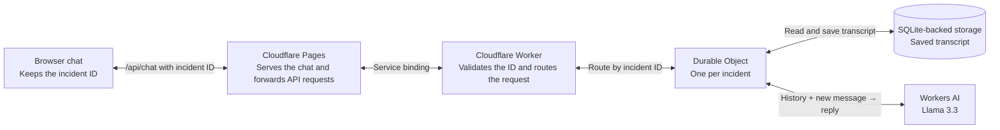

# Incident Triage

An AI chat for on-call investigation. Paste a sanitized symptom or log, then add evidence as you run checks. The assistant uses the saved incident transcript to update its guidance.

| Assignment component | Implementation |
| --- | --- |
| Chat | Browser UI served by Cloudflare Pages in the live demo |
| Coordination | Worker validates and routes requests. A Durable Object loads history, calls the model, and saves each completed exchange. |
| LLM | Llama 3.3 70B via Workers AI |
| State | One SQLite-backed Durable Object per incident |

## Live demo

[Open Incident Triage](https://cf-ai-incident-triage-eb2.pages.dev/). Cloudflare Pages serves the same browser assets and forwards `/api/chat` to the Worker over a service binding. The Worker still owns incident state and calls Workers AI.

## How it works



**Send an update.** The Durable Object reads the saved transcript, sends it to Llama with the new message, and saves the completed exchange before returning it to the browser.

**Refresh the page.** The browser reuses its saved incident ID to fetch the transcript. This read skips the model call. The next update uses the restored history as context.

## Run locally

With Node.js 22 and a Cloudflare account:

```sh
npm install
npx wrangler login
npm run dev
```

Open the URL printed by Wrangler. Static assets and Durable Object state run locally in development. Workers AI uses the Cloudflare account for real inference and may consume its quota. Deploy to your Cloudflare account with `npm run deploy`.

To redeploy the Pages frontend after deploying the Worker, run `cd pages && npx wrangler pages deploy --branch main`. The Pages project and its service binding must be in the same Cloudflare account as the Worker.

## Demo the memory

1. Send: “Checkout returns 502 after the 14:20 deploy. The origin health endpoint returns 200.”
2. Send: “We ruled out DNS. Errors only affect requests with large carts.”
3. Refresh the browser. Confirm both messages are still visible, then ask: “What do we know so far, and what should I check next?” The reply should use the earlier evidence and account for DNS having been checked.
4. Click **Start new incident**. The new conversation starts empty.

The browser keeps an opaque incident ID in local storage. Treat it as a private access key. Clearing site data or starting a new incident removes the browser's reference to the old chat. The server retains completed transcripts, up to 20 exchanges per incident. This prototype is intended for sanitized sample data.

AI development prompts are recorded in [PROMPTS.md](PROMPTS.md).
